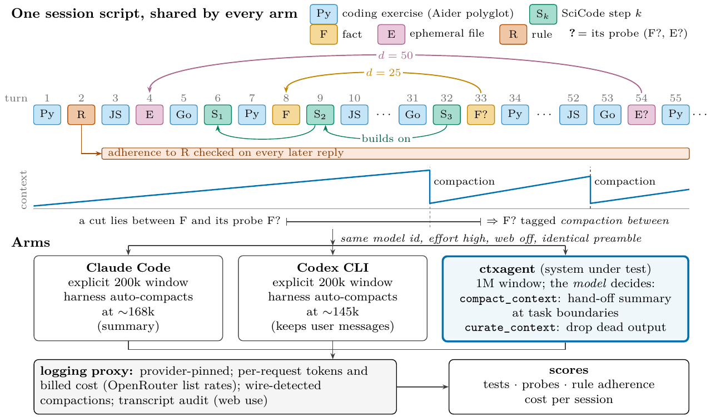

# ctxagent — letting the model manage its own context

A local LLM agent with a GUI whose **context is managed by the model itself**. Instead of a
harness that compacts the history when a token counter crosses a threshold, the model gets two
tools and a paragraph of principle: `compact_context` replaces finished work by a hand-off
summary it writes itself, `curate_context` drops tool output it has already acted on, and
`recall` restores anything losslessly. Below that sit automatic, cache-safe tiers (frozen
prefix, supersession, age-tiered masking with disk offload) that act only as a safety net.

This repository holds the agent, the benchmark that compares it with Claude Code, Codex and
OpenCode on 100–212-turn coding sessions and on hard sessions of SWE-bench Pro,
Terminal-Bench 4.0 and SciCode-Verified tasks, and every result row the paper reports.

**Paper:** *CTXAgent: Self-Controlled Context Management of LLM Agents* (Busch, Tacke, Aydin,
Feiler, Cyron, 2026; preprint identifier to follow).

Two findings, in one sentence each:

1. **Whether self-management pays depends on the model.** Under an identical instruction,
   Claude Opus 5.5 and GPT‑6.1 Sol compact regularly and cut the session cost by 16–58 % at
   about the same score; GPT‑6 Astra and Claude Fable 5.1 keep their context small, but the
   saving depends on their price lists; Sonnet 5.5 manages its context in one session of three,
   and Haiku 5.5 and Muse Wonder never compact.
2. **With a model that manages its context well, the harness saves cost.** With Opus 5.5 the
   self-managed agent matches Claude Code on task success and costs 34 % less than Claude Code
   at an explicit 200k window and 49 % less than its default, with no context window to choose.



---

## Install and run the GUI

Requirements: Python 3.11+, an [OpenRouter](https://openrouter.ai/keys) key (or an Anthropic
key for the direct route).

```bash
git clone https://github.com/MatthiasHBusch/CTXAgent.git
cd CTXAgent
python -m venv .venv && . .venv/bin/activate      # Windows: .venv\Scripts\activate
pip install -e .                                  # core; add [readers] for PDF/DOCX/XLSX readers, [all] for everything
cp .env.example .env                              # put OPENROUTER_API_KEY=sk-or-v1-... in it
ctxagent                                          # opens http://127.0.0.1:8765
```

`ctxagent` is the same launcher as `run.ps1` / `run.cmd` / `run.sh`: it refuses to reuse a
stale backend on the port, opens the browser and serves the GUI. Add a working directory in the
**Tools** tab before asking the agent to touch files; file and shell tools are confined to the
directories you list. Chats, blobs and settings live in `.ctxagent/` next to the package
(override with `CTXAGENT_DATA`). Install in editable mode (`-e`) from the clone: the GUI
(`web/`) and the data directory are resolved relative to the package's parent directory.

Extras: `pip install -e ".[readers]"` (PDF, DOCX, PPTX, XLSX, CSV, YAML, HTML readers),
`".[mcp]"` (expose the readers to other agents over MCP), `".[bench]"` (the benchmark),
`".[all]"`.

Tests: `python -m tests.test_compaction` (engine invariants), `python -m tests.test_readers`,
`python -m tests.run_all`.

## How the agent manages context

The policy under test is one paragraph of the system prompt (Appendix A of the paper) and two
tools:

- `compact_context(summary, keep_from, keep_ids)` — archive everything before a point and
  replace it by **one** summary segment the model wrote (goal, decisions and why, files changed,
  results, open issues, segment ids worth recalling). No summariser call, no extra cost; the
  archived tool results stay recallable by id.
- `curate_context(drop=[{id, note}])` — list the unreviewed tool results and replace the ones
  the model has acted on by its own one-line note. Everything not named is kept verbatim. The
  engine hints that a review is due every 25 tool batches; it never acts on the hint itself.

Underneath, the compaction engine runs after every turn and escalates only as far as pressure
requires: a cache-stable split that freezes older history byte-identically (so the provider's
prompt cache keeps hitting), supersession and duplicate collapse, age-tiered masking with disk
offload, and — never reached in the benchmark — LLM-backed condensation and a deep structured
summary. Nothing is deleted; every removal writes the original to a blob first. The engine
lives in `ctxagent/compaction/`; the tools and the system prompt in `ctxagent/`.

## The benchmark

`bench/` runs the **same model through several harnesses on byte-identical session scripts**
behind one logging proxy that records every request's tokens by class and the provider's billed
cost, pins the provider, detects compactions on the wire and audits transcripts for web use.

- Session scripts interleave Aider-polyglot exercises (Python, JavaScript, Go) and multi-step
  SciCode problems (later steps call functions written in earlier turns) with planted facts,
  ephemeral observations that exist only in the conversation, and standing rules checked on
  every later reply — so that information lost to compaction can become a task failure.
  Families: `mixdep:34@s` (101–115 turns), `sci:chatN` (clean chains), `marathon:0` (212 turns,
  ~1.5M tokens of raw history), and `heavy:s` (hard sessions: SWE-bench Pro, Terminal-Bench 4.0
  and SciCode-Verified tasks in their own containers; Docker under Linux or WSL, task selection
  in `bench/external/heavy_selection.json`).
- Harnesses: `ctxagent_live` (the frozen live configuration, 1M window, model-decided
  compaction), `ctxagent_live_noctx` (same binary, no context management), `claude_code`,
  `codex`, `opencode`, plus adapters for Letta Code and mini-swe-agent.
- Every session is one JSON row in `bench/results/*.jsonl` with per-turn scores, per-request
  tokens and cost, compaction events and tool counts; `bench/results/README.md` indexes the
  files by experiment. The harness adapters are described in
  [`bench/HARNESS_ADAPTERS.md`](bench/HARNESS_ADAPTERS.md).

To run it yourself:

```bash
pip install -e ".[bench]"
bash bench/external/fetch.sh            # Windows: powershell -File bench/external/fetch.ps1  (sources, Go, jest, OpenCode, Claude Code)
python -m bench.run show --task mixdep:34@0                      # print a session script, no model calls
python -m bench.run sweep --models anthropic/claude-opus-5.5 --harnesses ctxagent_live,claude_code \
  --windows 200000 --tasks mixdep:34@0 --reps 1 --out bench/results/my_run.jsonl --max-cost 20 --billed-cap 15
python -m bench.analysis bench/results/my_run.jsonl --fig-prefix bench/results/fig_my_run
```

`bench/external/` is not redistributed; `fetch.sh` / `fetch.ps1` pin the Aider polyglot
benchmark, SciCode, a portable Go toolchain, the shared jest install and the harness CLIs at the
versions used in the paper (see [`bench/external/README.md`](bench/external/README.md)).

## Layout

```
ctxagent/        the agent: server, tools, compaction engine (ctxagent/compaction/), readers
web/             the GUI
tests/           engine invariants, readers, UI smokes, model evaluation for the compaction model
bench/           benchmark runner, task families, harness adapters, analysis; results/
assets/          the benchmark design figure
```

## License and citation

Everything in this repository is released under the
[Creative Commons Attribution 4.0 International](LICENSE) license (CC BY 4.0). If you use the
agent, the benchmark or the results, please cite the paper (see [`CITATION.cff`](CITATION.cff)).

The benchmark builds on the [Aider polyglot benchmark](https://github.com/Aider-AI/polyglot-benchmark)
(Exercism exercises), [SciCode](https://github.com/scicode-bench/SciCode) and
[Context-Bench](https://github.com/letta-ai/context-bench); their licenses apply to their
sources, which are fetched rather than redistributed.
